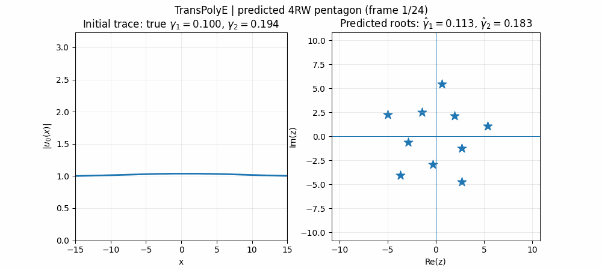

# TransPolyE

**Predicting characteristic polynomials of rogue-wave patterns from initial-boundary data with a Transformer.**

TransPolyE learns a direct mapping from initial and boundary observations of the focusing nonlinear Schrödinger (NLS) equation to the characteristic-polynomial representation of rogue-wave (RW) patterns. The model jointly predicts the polynomial class and two continuous polynomial parameters.

<p align="center">
  
</p>

> The GIF is optional. Generate it with `demo/make_demo_gif.py` or `demo/make_demo_gif.ipynb` after downloading a trained checkpoint and example data.

## Overview

For each sample, TransPolyE uses

- the initial trace \(u_0(x)\),
- the left boundary trace \(u_{b1}(t)\),
- the right boundary trace \(u_{b2}(t)\),

together with their physical coordinates. Real and imaginary parts are treated as two input channels. Each sampled point is represented as a token using

1. value projection,
2. physical spatio-temporal coordinate encoding, and
3. trace-type embedding.

A CLS token and a six-layer Transformer encoder are then used for joint classification and regression.

## Repository structure

```text
TransPolyE/
├── README.md
├── requirements.txt
├── .gitignore
├── model.py
├── data_utils.py
├── polynomials.py
├── train.py
├── predict.py
├── evaluate.py
├── demo/
│   ├── make_demo_gif.py
│   └── make_demo_gif.ipynb
├── assets/
├── checkpoints/
│   └── README.md
└── data/
    ├── README.md
    └── sample/
```

The public implementation intentionally excludes obsolete experimental versions of the model.

## Environment

The experiments were developed with Python 3.9 and PyTorch.

```bash
conda create -n transpolye python=3.9
conda activate transpolye
pip install -r requirements.txt
```

If you use a CUDA-enabled PyTorch build, install the PyTorch package appropriate for your CUDA environment first.

## Data format

Each MATLAB sample must contain a structure named `u_data` with three complex-valued traces:

```text
u_data.u0   initial trace
u_data.u1   left boundary trace
u_data.u2   right boundary trace
```

The metadata file `poly_data.txt` uses one sample per line:

```text
filename class_id gamma1 gamma2 domain_id t_min t_max x_min x_max
```

The training metadata file also contains one 12-value normalization-statistics line:

```text
u0_Re_mean u0_Re_std u0_Im_mean u0_Im_std
u1_Re_mean u1_Re_std u1_Im_mean u1_Im_std
u2_Re_mean u2_Re_std u2_Im_mean u2_Im_std
```

In the actual file these 12 values are written on a single line.

See `data/README.md` for the recommended directory layout.


## Small sample dataset

You do **not** need to regenerate the full dataset to create the example files included with this repository. A small representative subset can be copied directly from the original dataset:

```bash
python tools/make_sample_dataset.py \
  --source-data /path/to/full/test/matfile \
  --source-list /path/to/full/test/poly_data.txt \
  --output data/sample \
  --samples-per-class 1
```

This selects one deterministic representative sample per polynomial class in every domain present in the test metadata. Use `--domains ...` only if you want to restrict the public sample to selected domains. The resulting `data/sample/` directory can be used for a lightweight end-to-end check without retraining the model. If the MATLAB files are individually large, use only one domain so that the public sample remains compact.

After copying the pretrained checkpoint to `checkpoints/`, verify compatibility with:

```bash
python tools/verify_checkpoint.py checkpoints/best_model_multidomain.pth
```

## Training

Edit the paths in the `TrainConfig` block at the top of `train.py`:

```python
train_data_dir = Path("data/train/matfile")
val_data_dir = Path("data/val/matfile")
train_list = Path("data/train/poly_data.txt")
val_list = Path("data/val/poly_data.txt")
```

Then run:

```bash
python train.py
```

The default public configuration follows the reported main training setup:

- `Nx = 200`
- `Nt = 100`
- `d_model = 256`
- 8 attention heads
- 6 Transformer encoder layers
- 6 polynomial classes
- batch size 50
- AdamW
- learning rate \(6\times10^{-4}\)
- weight decay \(10^{-5}\)
- regression loss weight 10
- gradient clipping at 1.0
- 100 epochs
- random seed 3407

The best validation checkpoint is saved to

```text
checkpoints/best_model_multidomain.pth
```

## Prediction

Edit the `PredictConfig` block in `predict.py`:

```python
checkpoint_path = Path("checkpoints/best_model_multidomain.pth")
sample_path = Path("data/sample/example.mat")
t_range = (-5.0, 5.0)
x_range = (-5.0, 5.0)
```

Then run:

```bash
python predict.py
```

The script prints

- predicted polynomial class,
- predicted \(\gamma_1,\gamma_2\),
- scaled polynomial-root coordinates.

The loader remains compatible with the original training checkpoint format, which stores `Nx`, `Nt`, the training normalization statistics, and `model_state_dict`.

## Evaluation

To evaluate a listed test set, edit `EvalConfig` in `evaluate.py` and run

```bash
python evaluate.py
```

The script reports

- classification accuracy,
- MSE,
- MAE,
- aggregate relative \(L_2\) error,
- per-domain metrics.

## Animated demo

Two equivalent options are provided:

```text
demo/make_demo_gif.py
demo/make_demo_gif.ipynb
```

The demo selects samples from one RW class, orders them by the polynomial parameters, and shows

```text
changing initial trace
        ↓
     TransPolyE
        ↓
predicted polynomial parameters
        ↓
predicted complex-root distribution
```

The output is saved as

```text
assets/transpolye_demo.gif
```

Using one fixed class is recommended because it makes the animation show continuous parameter variation rather than abrupt changes between different polynomial families.

## Dataset and checkpoint release


For details on how the data was generated, please refer to this paper and our previous work：
```text
J. Comput. Phys. (2025) 539: 114243.
```
After uploading the data, replace the placeholders below:


A small example file can be kept under `data/sample/` so that users can test `predict.py` without downloading the full dataset.

## Reproducibility notes

The following must remain consistent between training and inference:

- real/imaginary channel order,
- normalization statistics,
- `Nx` and `Nt`,
- physical domain ranges,
- class-to-polynomial mapping,
- root scaling convention.

The cleaned release centralizes these operations in shared modules to reduce training/inference mismatch.

## Associated paper

**Predicting the characteristic polynomials of rogue wave patterns from initial-boundary data via deep learning**

Please add the final journal citation and DOI after publication.

```bibtex
@article{TransPolyE,
  title   = {Predicting the characteristic polynomials of rogue wave patterns from initial-boundary data via deep learning},
  author  = {Zhe Lin and Yong Chen},
  journal = {Physical Review E},
  year    = {2026},
  doi     = {doi.org/10.1103/qdlp-2gzb}
}
```

## License

Choose a license before making the repository public. For academic research code, MIT and BSD-3-Clause are common permissive choices; use the license that matches your publication and institutional requirements.
